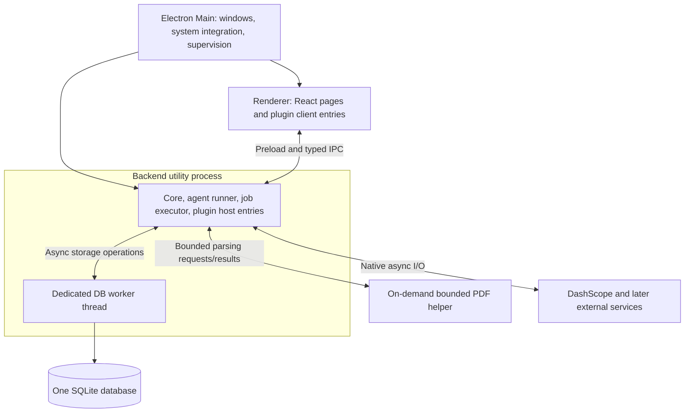

# Whim Application Design

Status: implementation specification; the headless text-agent increment is implemented. This document also describes functionality that remains planned. Last updated: 2026-11-04.

This document defines Whim's architecture, module boundaries, interface semantics, and data invariants. A change to these decisions must update this document and explain the reason in the same change. Interface examples describe the intended contracts; exact types will be refined during implementation. Features marked as later work are outside the first release.

[agent.md](agent.md) specifies the main agent's async generator, interruption, pre-reasoning inbox, background jobs, context epochs, compaction, tool batches, automatic approval, skills, memory, and middleware. [roadmap.md](roadmap.md) orders implementation, starting with the agent and durable context rather than the desktop interface. [runtime.md](runtime.md) describes the currently executable subset.

## 1. Goals and initial scope

Whim is a macOS-only Electron application combining personal chat, coding sessions, information subscriptions, music, and dashboard widgets in one workspace. Pages are views over application capabilities; navigating between them must not terminate background work. Whim owns its main chat independently of external coding agents connected through ACP.

The first release delivers a minimal, recoverable end-to-end system:

- An Electron and React interface using shadcn/ui, Tailwind CSS, and lucide-react, with English and Simplified Chinese language options.
- TypeScript plugins with a shared release version.
- DashScope Chat through the OpenAI Responses-compatible protocol.
- DashScope Decision through the TypeSafe System One-compatible protocol.
- Main chat, model and plugin settings, and per-call token accounting.
- Bounded PDF attachments and page-based reading, with explicit native-versus-processed routing.
- Local coding tools, automatic model-backed approval, skills, and file memory with cache-preserving incremental context updates.
- User interruption, durable message insertion before reasoning, and bounded background jobs with status/output/cancellation tools.
- One SQLite database with a complete append-only agent journal: messages, state, tasks, compaction, execution facts, and durable deliveries.
- Stable record IDs and ordered session positions that preserve the option of future forks.
- OpenTelemetry tracing for agent runs and model calls, independent of durable execution.
- An activity index containing operation types and object references without copies of content or duplicate outcome state.

The first release excludes TTS, ASR, vector storage, monetary cost calculations, a generic model-constraint engine, distributed execution, plugin sandboxing, a plugin marketplace, and production code hot swapping. ACP, information sources, music, and dashboard widgets are subsequent integrations with defined extension boundaries.

A local main chat means that Whim owns the conversation and execution lifecycle. Model inference still runs through DashScope.

## 2. Principles

1. **The database is the source of truth for durable business state.** In-memory queues, context views, and UI state may be lost. Accepted input, pending work, and committed results must be recoverable.
2. **The agent journal is append-only.** Messages, state transitions, tasks, compaction, and execution facts are immutable records. Agent views and mutable scheduling projections are rebuildable. Global activity stays a minimal operation index; unrelated application settings do not require a general event-sourcing framework.
3. **Commit before acknowledgment and external execution.** Persist accepted input and execution intent before confirming submission. Persist tool identity and arguments before performing external effects.
4. **Notifications may be lost; work must survive.** IPC provides wakeups and live presentation. The database determines what remains to be processed.
5. **Activity indexes reference content.** Message bodies belong to conversations; collected content belongs to source items. Activity entries reference their owning records.
6. **Separate protocol, capability, and connection.** A provider name alone does not determine an API, model capability, or account availability.
7. **Design package, process, and session boundaries separately.** A package is not a process, and a session is not a thread.
8. **Default to async execution with explicit ownership.** I/O uses native asynchronous interfaces. Background work has a lifetime, cancellation signal, concurrency limit, and result owner.
9. **Define interfaces at replaceable boundaries.** Models, tools, external services, execution hosts, and storage ports need contracts. Ordinary internal functions do not need service wrappers.
10. **Establish recovery semantics before optimizing.** Verify transactions, deduplication, and crash recovery before adding batching, caches, or additional workers.

The source-of-truth rule does not require persisting every mouse event, HTTP byte, or streamed token. Uncommitted stream fragments, open connections, and transient presentation state may be lost. Credentials live in macOS Keychain, with references in the database; Keychain is a credential boundary rather than another business database.

## 3. Packages and dependencies

Use a pnpm workspace with four foundational packages and plugins for concrete external capabilities. Contracts remain inside core; plugin SDK, host, and SQLite implementation are modules rather than additional packages.

| Directory / package                   | Responsibility                                                                                               |
| ------------------------------------- | ------------------------------------------------------------------------------------------------------------ |
| `apps/desktop`                        | Electron main, preload, and React renderer; process creation and implementation assembly                     |
| `packages/core` / `@whimkit/core`     | Commands, queries, plugin lifecycle, durable execution, messaging, SQLite storage, and public business types |
| `packages/models` / `@whimkit/models` | Model cards, Chat/Decision types, capability validation, and adapter contracts; no persistence               |
| `packages/agent` / `@whimkit/agent`   | Main-chat loop, context construction, and tool scheduling through injected ports                             |
| `packages/ui` / `@whimkit/ui`         | Shared shadcn components, themes, UI slots, data hooks, and presentation components                          |
| `packages/plugin-dashscope`           | One provider plugin with independent Chat and Decision adapters and model cards                              |
| `packages/plugin-memory`              | Bundled file-memory strategy and agentic middleware using Core services; no private database                 |

These are target packages, not a claim that the current repository already implements them. Use `models` for model contracts and adapters; do not maintain parallel `llm` and `models` abstractions.

Core exposes subpaths according to runtime boundaries:

- `@whimkit/core`: browser-safe business types and schemas.
- `@whimkit/core/plugin`: plugin definitions and host capability interfaces.
- `@whimkit/core/client`: typed clients for renderer code.
- `@whimkit/core/runtime`: Node runtime, storage, and scheduling implementations.

Models does not depend on Electron or core runtime. Core's model service uses models contracts. Agent depends on models and core ports; core does not import agent. Desktop assembles the system and injects the agent runner into core. Plugins use public contracts rather than importing another plugin's implementation. UI code does not import Node implementations.

Main chat, settings, reader, and coding pages initially live in desktop feature directories. Independent installation or replacement is the reason to create a plugin package.

UI actions and agent tools share three application interfaces:

- `command({ operationId, type, input, expectedVersion? })` submits a change and returns a durable receipt.
- `query({ type, input })` reads paginated projections or facts.
- `subscribe({ topic, afterSeq? }, signal)` observes changes.

Public schemas define the types and runtime IPC validation. A receipt confirms acceptance of input and work, while later execution state reports completion. Reconnection obtains a snapshot with a sequence position and catches up on committed records after that position, avoiding gaps between querying and subscribing.

## 4. Processes, threads, and asynchronous execution

The first release has three long-lived application-level processes: Electron Main, Renderer, and one Backend utility process. Backend hosts Core, the agent runner, and trusted backend plugin entries. One DB worker thread inside Backend runs SQLite. PDF parsing uses a bounded on-demand helper process so malformed files and expensive decoding do not run on the Backend event loop. Electron and Node manage additional internal execution units; these are ownership boundaries rather than an exact OS thread count.

The topology keeps presentation independent of business execution without a separate plugin RPC layer.



Main owns windows, menus, Keychain access, updates, and Backend supervision. Renderer uses context isolation with Node integration disabled. Preload exposes validated application operations rather than arbitrary IPC, SQL, or Node access.

Backend services and trusted plugin host entries use ordinary typed calls. Model requests are concurrent async tasks, not one thread per call. A session has at most one context-advancing runner. Core's job executor owns tool lifetimes independently of that runner's wait. Backgrounding changes durable ownership/wait state, not process placement, and does not relaunch the operation. Different sessions, jobs, plugin workloads, and model connections have bounded concurrency; work waiting for capacity remains durable.

Network calls use native async I/O, files use `fs/promises`, and external programs use asynchronous spawn. Operations propagate AbortSignal and have owned cleanup. Streams use AsyncIterable with bounded buffers, explicit terminal/error events, and cancellation. Navigation releases subscriptions without canceling business work. A subscriber does not change an in-flight request's streaming mode.

The synchronous SQLite driver, initially `better-sqlite3`, runs only in the DB worker. Store methods return promises; each short transaction is one worker request with no network waits. A caller timeout does not prove rollback: check the operation ID before retrying. Pin and validate the driver in Electron's actual runtime.

A trusted plugin can block or crash Backend. This failure domain is accepted for the first bundled adapters; it is not a permission sandbox. Main can restart Backend and recover committed state. A DB worker failure stops new work until storage is reconciled. A native crash may terminate the whole Backend. External requests already sent remain subject to unknown-outcome handling.

Add bounded CPU workers or a dedicated plugin process only when measured workloads or failure isolation require them. Native async tools stay in Backend, Bash/ripgrep use owned child processes, and PDF uses its helper. Subprocesses belong to an explicit job/plugin scope; foreground jobs are tied to run cancellation until a committed background handoff. Do not allocate a process merely because another package, plugin, session, or background job exists.

Shutdown stops admission, drains or cancels foreground and background jobs, disposes plugins, and closes storage last. Closing the window hides it while work continues; explicit application exit stops execution. User Stop fences the active agent run and holds automatic continuation; already-backgrounded jobs remain visible and separately cancellable. A Stop-and-cancel-jobs command covers both. The initial design does not promise process survival across application exit or Backend crashes.

Implementation references: [Electron utilityProcess](https://www.electronjs.org/docs/latest/api/utility-process), [Node workers](https://nodejs.org/api/worker_threads.html), [better-sqlite3](https://github.com/WiseLibs/better-sqlite3).

## 5. Plugins

### 5.1 One package, separate runtime entries

A plugin is one versioned npm package, not one execution environment. It may contain a backend `host` entry, a frontend `client` entry, both, and optional styles. Host code runs in Backend; client code runs in Renderer. They communicate through typed commands, queries, and subscriptions, never shared mutable memory or direct Node access from UI.

A plugin can therefore provide a settings panel, invoke backend work, and stream progress to a custom view. Host and client activation/disposal are separate; unmounting a client view does not stop its backend task.

The manifest identifies the entries without requiring a package per entry.

```json
{
    "name": "@whimkit/plugin-dashscope",
    "version": "0.1.0",
    "type": "module",
    "whim": {
        "manifestVersion": 1,
        "host": "./dist/host.js"
    },
    "peerDependencies": {
        "@whimkit/core": "0.1.0",
        "@whimkit/models": "0.1.0"
    }
}
```

A plugin with UI adds `client` and `styles` paths. Author entries in TS/TSX and publish ESM, declarations, and compiled styles. The initial DashScope plugin registers separate Chat and Decision adapters. Shared packaging does not merge their protocols or interfaces.

Initially plugins ship with the application. Keep manifest validation and loading, but defer runtime npm installation, a marketplace, and arbitrary remote UI bundles. A bundled test fixture will verify a plugin with both entries before that contract is relied on.

### 5.2 Registration and ownership

The host API exposes model/tool registration, scoped commands/queries, and owned task/disposal facilities. The file-memory plugin additionally uses the agent's typed middleware and context-source contracts. Core owns persistence and model invocation accounting. Plugins do not need a general-purpose database API or public message bus to implement these features.

Plugin dependencies name capabilities, not implementation imports. Validate versions, configuration, dependencies, and cycles. Await activation and publish registrations only after success; dispose partial resources on failure.

Application, plugin, session, run, and UI-subscription scopes define ownership. Every listener, timer, connection, and subprocess has a disposer. Background promises are tracked. Observe-only events do not provide durable delivery.

A plugin's installed code, desired enabled state, and actual availability are distinct. Disable first stops admission, then drains/cancels work and releases resources in reverse dependency order. Business history remains. Uncooperative host code may require restarting Backend; uncooperative client code may require reloading Renderer.

### 5.3 Configuration and upgrades

A running attempt retains its prepared configuration snapshot and adapter generation. Non-prompt settings changes affect subsequent preparation. System instructions, model route, prompt-affecting options, and tool definitions remain frozen until successful compaction starts a new context epoch. Revocations stop affected execution immediately without rewriting old prompts. Package upgrades activate after restart, not production hot swapping; an incompatible context renderer requires explicit epoch migration through compaction.

Recovery never silently executes an old plan against incompatible code. An incompatible pending plan is blocked; an explicit replan appends a new plan with its new version and reason. Interrupted attempts retain their terminal/unknown facts. No live request or unreconciled external effect is blindly replayed after an upgrade.

When an information-source plugin first needs private durable data, define its schema ownership, migration, decoding after uninstall, and commit boundary with that feature. Do not introduce an arbitrary namespaced data store beforehand.

## 6. Models and adapters

### 6.1 Identity layers

Every invocation distinguishes four identities:

| Concept    | Example                                                | Meaning                                          |
| ---------- | ------------------------------------------------------ | ------------------------------------------------ |
| Provider   | `dashscope`                                            | Service vendor                                   |
| Adapter    | `dashscope-responses` or `dashscope-systemone`         | Protocol conversion and vendor-specific behavior |
| ModelCard  | A concrete model under an adapter, with a revision     | Capabilities exposed on that invocation route    |
| Connection | A regional workspace endpoint and credential reference | The user's configured access path                |

A model ID alone does not establish identical capability across regions, APIs, or accounts. Effective capability is the intersection of the card, implemented adapter behavior, connection configuration, and known restrictions. Authentication, connectivity, rate limits, and availability are tracked separately from the static card.

### 6.2 Model cards

Every model, including Decision, has a card. Cards contain identity, capabilities, and limits. They contain no prices, currencies, rates, cost estimates, or billing rules. The first release has Chat and Decision variants only.

Cards describe content formats with concrete media types, such as `text/plain`, `image/png`, `image/jpeg`, and `application/pdf`. Broad categories such as `image` cannot establish attachment compatibility. Media types follow the [IANA registry](https://www.iana.org/assignments/media-types/); normalize the type/subtype to lowercase, keep parameters separate, and do not use wildcard declarations such as `image/*` as evidence of format support.

The card records documented native model capabilities and protocol-specific delivery routes. Adapter implementation availability and application budgets are separate and cannot overwrite these facts. Application-side extraction, OCR, or transcoding does not expand the model's native capabilities. Input formats form a positive allowlist. Tool capabilities are booleans; an unlisted tool on the selected model page is not supported. Content type remains distinct from delivery method.

```ts
type Support = 'supported' | 'unsupported' | 'unknown';
type MediaType = `${string}/${string}`;
type InputDelivery = 'text' | 'structured-value' | 'inline-bytes' | 'file-id' | 'url';

interface InputMediaRoute {
    delivery: InputDelivery;
    maxBytes: number | null;
    maxPages?: number | null;
}

interface InputMediaSupport {
    routes: readonly [InputMediaRoute, ...InputMediaRoute[]];
}

interface ModelCardBase {
    id: string;
    revision: number;
    provider: string;
    adapterId: string;
    modelId: string;
    label: string;
    status: 'active' | 'deprecated' | 'unknown';
    inputMedia: Readonly<Partial<Record<MediaType, InputMediaSupport>>>;
    outputMedia: Readonly<Partial<Record<MediaType, Support>>>;
    contextTokens: number | null;
}

interface ChatModelCard extends ModelCardBase {
    kind: 'chat';
    maxOutputTokens: number | null;
    requestLimits: {
        maxAttachments: number | null;
        maxAttachmentBytes: number | null;
        maxRequestBytes: number | null;
    };
    capabilities: {
        streaming: boolean;
        tools: boolean;
        structuredOutput: boolean;
        thinking: boolean;
        webSearch: boolean;
        webFetch: boolean;
    };
}

interface DecisionModelCard extends ModelCardBase {
    kind: 'decision';
    questionTypes: readonly ('choice' | 'score' | 'noul')[];
    maxQuestions: number | null;
    maxChoices: number | null;
    maxScoreLevels: number | null;
}

type ModelCard = ChatModelCard | DecisionModelCard;
```

`MediaType` is a readable type sketch, not sufficient validation: public schemas validate concrete type/subtype values and reject wildcards and embedded parameters. Input media is an allowlist: an absent MIME type is unsupported. Do not add unsupported/unknown entries or redundant support flags. Each entry requires at least one documented route; the application enables only routes its adapter implements. Per-route `maxBytes` bounds the original file; `maxPages` applies to paginated documents and is omitted only when inapplicable. A null limit means unknown, not unlimited. `requestLimits` separately bounds file count, aggregate original bytes, and the encoded request body. The application still enforces its own bounds. Adapter preparation checks task-dependent limits, dimensions, codecs, and other known restrictions without inventing a generic constraint language. MIME type alone does not establish that every file with that type is valid.

Delivery describes how content reaches the API: `text` and `structured-value` are logical input values; `inline-bytes` includes protocol encodings such as base64; `file-id` requires an implemented upload route; `url` requires a resource the provider can actually access. A local path is not a provider-accessible URL. Encoding or uploading original bytes is transport preparation, not content conversion. Support for a text value does not imply support for uploading a text file.

Decision returns structured decisions represented as `application/json`; `kind` and `questionTypes` define their schema. Its accepted state representations are declared separately in `inputMedia`. Do not invent a generative output-token limit. Chat initially implements `text/plain`, plus the PDF attachment paths below. Native `application/pdf` is enabled only on an implemented, verified route; processed PDF support never changes that native flag. These media types describe logical content, not the HTTP JSON envelope or SSE stream used to carry it. A JSON response envelope alone does not establish structured-output capability.

`webSearch` and `webFetch` describe native API capabilities. Installing an application search tool does not mark every model as supporting native search. The application intersects these native declarations with the adapter’s implemented features before enabling an operation.

Model cards are independent JSON files under `packages/plugin-dashscope/src/cards/`, validated at load time. Every model declares its own values; do not infer capabilities or limits from a model-name prefix. Application admission budgets and source-verification notes stay outside these files. See [model-verification.md](model-verification.md) for development references.

Thinking uses a fixed application enum: `off`, `minimal`, `low`, `medium`, `high`, `xhigh`, `max`. Each JSON card supplies a `thinkingLevelMap` from these levels to provider-native strings, numeric budgets, booleans, or null (unavailable). Missing mappings are also unavailable; the UI offers only mapped levels. `defaultThinkingLevel` is explicit. Adapters serialize the mapped value into their API's actual field; they never send the application label blindly, invent numeric budgets, or silently downgrade an unsupported selection. DashScope Responses maps strings to `reasoning.effort` and booleans to `enable_thinking`; it rejects numeric mappings because this route has no implemented numeric-budget parameter. Future budget-based adapters can use numeric values without changing the UI enum. `thinkingRequired` forbids `off`. Model and thinking selection belong to the frozen session/request state so restart and retries keep the same semantics.

#### Attachment admission and preparation

Core derives attachment availability from the effective model card, implemented delivery paths, enabled application processors, and file limits. The frontend consumes this shared result; it does not maintain a separate MIME allowlist or infer support from filename extensions. Picker hints list candidate formats; actual admission checks the selected file and current connection before preparing a call.

Each available route identifies a concrete source media type and how it will be handled. This is an application capability derived from the card, not a native model capability stored back into it.

```ts
type AttachmentRoute =
    | { kind: 'native'; mediaType: MediaType; delivery: InputDelivery }
    | {
          kind: 'processed';
          mediaType: MediaType;
          processorId: string;
          processorRevision: string;
          outputMediaTypes: readonly [MediaType, ...MediaType[]];
          noticeKey: string;
      }
    | { kind: 'unavailable'; mediaType: MediaType; reasonKey: string };
```

For a native route, the API receives the original content in a supported representation and performs its own interpretation. For a processed route, an installed processor extracts, renders, or converts content, and every resulting part must pass native input validation. Processor declarations name concrete input/output types, bounds, and possible information loss. Start with explicit single-step processors when required; do not build an automatic conversion graph. Decoding a text attachment into a text input is also an explicit preparation route.

These examples illustrate routing decisions, not claims about the initial DashScope model set:

| Source                      | Effective capability                                                      | Application behavior                                                                                                       |
| --------------------------- | ------------------------------------------------------------------------- | -------------------------------------------------------------------------------------------------------------------------- |
| `image/png` or `image/jpeg` | That exact type and a usable byte/upload route are supported              | Send original content through the adapter                                                                                  |
| `application/pdf`           | Native PDF input and its delivery route are supported                     | Send the PDF for API-side interpretation                                                                                   |
| `application/pdf`           | No native PDF route; an enabled extractor produces supported `text/plain` | Offer text extraction, with a notice that layout/images may be lost; scanned pages require a separate implemented OCR path |
| Any other type              | No verified native route or enabled processor with supported output       | Reject with a reason; do not upload speculatively                                                                          |

The frontend shows direct, processed, or unavailable status and explains conversion effects in both languages. Prefer a usable native route; do not silently fall back to lossy extraction after an API failure. Record the user's selected processing route. File-picker `accept` values are hints, not validation; filename extensions and client-reported MIME values must be checked against the actual content where applicable. [HTML file input specification](https://html.spec.whatwg.org/multipage/input.html#attr-input-accept).

Preparation revalidates source bytes, processor output, delivery support, and final context/request limits. A model or connection change invalidates the prior admission result. Persist the original artifact reference, detected media type, selected processor/version/options, derived content references, and final model input references in the durable plan. Preserve exact derived content for replay rather than rerunning a possibly changed processor. Remote file IDs are transport references, not the sole copy of an attachment.

#### PDF capability and limits

PDF attachment support is required, but its native route is model/protocol-specific. The documentation checked on 2026-11-04 contains the following distinctions and a conflict; these are documented limits, not live integration results.

| Route                                                               | Documented limits                                                                                                                                                    | Whim decision                                                                                                                                                  |
| ------------------------------------------------------------------- | -------------------------------------------------------------------------------------------------------------------------------------------------------------------- | -------------------------------------------------------------------------------------------------------------------------------------------------------------- |
| General Chat PDF understanding through Chat Completions / DashScope | 150 MB per file, 256 pages, URL or Base64; selected Qwen3.8 models and regions                                                                                       | A separate explicitly selected Chat adapter/card may provide native PDF analysis; it is not an automatic fallback for the main Responses conversation          |
| General Chat through Responses                                      | Responses reference lists `input_file` for Qwen3.8 Max/Flash with a 100 MB URL input; the PDF guide explicitly says Responses does not deliver PDFs despite HTTP 200 | Omit native PDF from the input allowlist until model/region-specific ingestion is proven; do not copy either limit into an enabled card on documentation alone |
| `qwen3.5-ocr` through Responses                                     | 100 MB; 50 pages with `document_parsing`, otherwise 10 pages                                                                                                         | A distinct document-processing operation, not proof that a general Chat model accepts PDFs; optional after its adapter is implemented                          |

Sources: [PDF understanding](https://help.aliyun.com/zh/model-studio/pdf-understanding), [Responses parameters](https://help.aliyun.com/en/model-studio/qwen-api-via-openai-responses), [OCR PDF parsing](https://help.aliyun.com/zh/model-studio/qwen-vl-ocr). Provider documentation uses MB; store conservative decimal byte ceilings unless the vendor clarifies another unit. Do not transfer page/file limits between routes or treat a single-file limit as a total-request limit.

The first dependable Responses-chat path is bounded local PDF text extraction and `ReadPDF` page selection. Scanned/image-only pages require a configured OCR/native-analysis path or a visible unsupported result; do not report an empty extraction as a fully read document. Native PDF analysis, when configured, is an explicit child Chat invocation with its own card, usage, and trace. Its findings enter the main chat as bounded, page-referenced tool content; the main conversation's model and cached prefix do not change. PDF bytes are not inserted into a function result if that protocol only accepts text/images there.

Configure application attachment policy separately from provider cards. These are conservative initial application defaults, to be validated in the packaged macOS runtime, not provider maxima.

```ts
interface AttachmentPolicy {
    revision: number;
    maxFilesPerMessage: number;
    maxTotalBytesPerMessage: number;
    maxEncodedRequestBytes: number;
    pdf: {
        maxFileBytes: number;
        maxPages: number;
        maxExtractedTextBytes: number;
        maxToolResultTokens: number;
        parseTimeoutMs: number;
        maxConcurrentParsers: number;
    };
}

const initialAttachmentPolicy: AttachmentPolicy = {
    revision: 1,
    maxFilesPerMessage: 4,
    maxTotalBytesPerMessage: 32 * 1024 * 1024,
    maxEncodedRequestBytes: 48 * 1024 * 1024,
    pdf: {
        maxFileBytes: 20 * 1024 * 1024,
        maxPages: 100,
        maxExtractedTextBytes: 1024 * 1024,
        maxToolResultTokens: 4000,
        parseTimeoutMs: 30_000,
        maxConcurrentParsers: 1,
    },
};
```

Core stores policy revisions and exposes effective limits to the frontend. For every dimension, use the strictest applicable application, adapter, provider, and remaining request/context limit. Unknown provider limits remain unknown; an application cap does not prove upstream acceptance. A lower verified provider page limit wins over the 100-page local default. UI configuration may lower limits; raising them requires remaining within the build's tested resource envelope and known provider bounds. Processor resource ceilings are implementation constraints, not permission to raise a model's limit. Never silently relax a limit after an error.

Check all retained attachments in the complete request, not just newly attached files. For Base64, account for `4 * ceil(bytes / 3)` plus data-URI, JSON, history, and tool-schema overhead before allocation. For URL inputs, a small request body does not exempt the underlying PDF from file/page limits; obtain and snapshot bounded bytes before admission. Do not make local files public solely to satisfy a URL-only API. Any upload route needs explicit implementation and authorization.

The ingestion path must contain failures rather than treating an attachment as an unbounded chat message:

1. Renderer sends a selected-file handle/reference and metadata, never a full Base64 document over IPC. Backend checks file size before reading, then enforces a byte cap while reading the opened file and computing its hash. Revalidate changed sources.
2. Check file format, parseability, page count, encryption, and output bounds in an on-demand document helper process. Reject encrypted or malformed documents with a localized reason. Never execute embedded PDF scripts or follow embedded references automatically.
3. Limit parser concurrency and queue size. Initially allow one active parser and four queued jobs, with a 256 MiB V8 heap bound, a 512 MiB RSS watchdog threshold, a bounded output channel, and the configured timeout; terminate/reap it on violation. These are application defaults requiring packaged-runtime tests, not hard OS memory guarantees: heap limits exclude native allocations and RSS sampling can overshoot. The helper process is a justified addition for untrusted document parsing; it does not own the database.
4. Retain admitted original bytes as immutable Core-managed files and commit their verified references after durable publication. Store exact page content consumed by the agent in SQLite. Pass only IDs and bounded chunks to UI/model preparation. Temporary ingestion files are not authoritative until committed and are cleaned up on recovery.
5. Track preparation as pending/ready/rejected/failed independently from the running conversation. Commit a submitted input only with valid prepared references. A parser failure or oversized attachment leaves the draft and other sessions usable; previously committed conversation state is unaffected.
6. Select bounded pages/snippets for context. The extracted-text cap is a processing cap, not permission to inject 1 MiB into the prompt. Respect the smaller tool-result token budget and remaining context allowance; return page ranges and continuation references instead of silent truncation. Rendered image output needs additional pixel/byte limits before enabling that path.

Separate local parse timeout from remote model timeout. The native PDF guide allows a long first-response wait of up to 300 seconds; a native document operation therefore needs a configured cancellable request timeout, visible progress, and no assumption that cancellation stopped remote processing. Oversize input and provider errors produce typed attachment/tool failures, never an automatic replay loop or mutation of old context.

### 6.3 Asynchronous invocation

Chat and Decision share discovery and preparation but have separate call contracts. Preparation freezes the card, connection and adapter versions, and effective parameters into a durable call plan. Runtime handles themselves are not persisted.

```ts
interface ChatAdapter {
    generate(request: ChatRequest, signal: AbortSignal): AsyncIterable<ChatEvent>;
}

interface DecisionAdapter {
    evaluate(request: DecisionRequest, signal: AbortSignal): Promise<DecisionResult>;
}

interface TokenUsage {
    inputTokens?: number;
    outputTokens?: number;
    totalTokens?: number;
    reasoningTokens?: number;
    cachedInputTokens?: number;
}
```

Chat events distinguish text/thinking deltas, complete output items, completion, failure, and final usage. A non-streaming HTTP response can become one complete result followed by a terminal event, avoiding a second agent loop. An interrupted stream is not committed as a successful answer merely because it reached EOF.

Decision requests contain `state` and questions keyed by ID. Answers form a discriminated union: a choice, a score with its scale, or a noul probability. Preserve returned distributions and confidence. Business callers choose any threshold that converts noul into a boolean. Confidence is not treated as an empirically calibrated correctness rate.

### 6.4 Initial protocol routes

The adapters use the following routes. These contracts require live verification against the selected account before release.

| Plugin                              | Protocol and path                                         | Implementation                                                                                                               |
| ----------------------------------- | --------------------------------------------------------- | ---------------------------------------------------------------------------------------------------------------------------- |
| `plugin-dashscope` Chat adapter     | OpenAI Responses: `POST /compatible-mode/v1/responses`    | Async Responses calls through the OpenAI TypeScript SDK with a DashScope base URL; vendor extensions stay inside the adapter |
| `plugin-dashscope` Decision adapter | TypeSafe System One: `POST /compatible-mode/v1/systemone` | Native fetch with the JSON protocol and typed decision semantics                                                             |

Connections store region, workspace, and base URL explicitly. The initial Decision card targets the documented `decision-model-preview` route in Beijing or Singapore, subject to account availability. [DashScope Decision API](https://docs.bailian.console.aliyun.com/en/model-studio/decision-model-api).

Chat starts with a small verified card set rather than assuming complete Responses support across the provider's catalog. SDK types do not establish service support for every field. The adapter does not silently fall back to Chat Completions. Disable implicit SDK retries so the runtime owns attempt accounting. [DashScope Responses API](https://help.aliyun.com/zh/model-studio/qwen-api-via-openai-responses).

The initial catalog targets the following six DashScope-hosted model IDs. New conversations default to `qwen3.8-max`. Do not populate the picker with older model generations or substitute third-party-hosted IDs such as `ZHIPU/GLM-5.3` or `kimi/kimi-k3`.

| Model ID               | Role                             |
| ---------------------- | -------------------------------- |
| `qwen3.8-max`          | Default Chat model               |
| `qwen3.8-flash`        | Faster Qwen alternative          |
| `deepseek-v4.1-flash`  | Latest DeepSeek Flash generation |
| `deepseek-v4-pro-0813` | DeepSeek Pro alternative         |
| `glm-5.3-prime`        | DashScope-hosted GLM Prime       |
| `kimi-k3`              | DashScope-hosted Kimi            |

This is the selected integration scope, not a claim that all six adapters have passed validation. Enable a model only after its protocol, mandatory reasoning behavior, continuation fields, MIME routes, and limits are implemented and verified. Existing sessions retain their frozen model card; changing the default must not rewrite their context.

Verified documentation on 2026-11-04 lists `glm-5.3-prime` in Beijing and Singapore, with the original model's capabilities and limits ([Prime mode](https://help.aliyun.com/en/model-studio/prime-mode)). Kimi's dedicated reference requires thinking for `kimi-k3` and says Responses is not yet supported, while the general Responses reference lists it. Resolve this conflict through an explicit route test before enabling it; never send the text adapter's unconditional thinking-disable option to Kimi. If Chat Completions is required, provide a separately identified adapter with durable reasoning continuation rather than silently switching protocols ([Kimi reference](https://help.aliyun.com/en/model-studio/kimi-api)).

Main chat constructs input from local records on every request and uses `store: false`. Recovery does not require `previous_response_id` or remote Conversations. Preserve the item IDs, call IDs, reasoning information, and other supported fields needed for continuation; storing only `output_text` is insufficient. Each adapter follows its endpoint's rules for replaying items. [Responses protocol guidance](https://developers.openai.com/api/docs/guides/migrate-to-responses).

### 6.5 Token accounting

Every actual model request has its own attempt ID and associated usage. This includes main chat, Decision, approval, memory, document analysis, retries, and compaction calls. Preserve reported usage even when a request fails.

- Store reported input, output, total, reasoning, and cached-input tokens. Missing fields remain unknown rather than becoming zero.
- Reasoning and cached-input counts are breakdowns of their respective totals where the protocol defines them that way; do not add them again.
- If total usage is absent but input and output are both known, derive their sum. Otherwise display known counts and completeness separately.
- The initial Decision route reports input tokens only. Do not fabricate output tokens or a complete total.
- Deduplicate usage by attempt. Distinct attempts remain distinct consumption even when they belong to one logical operation.
- Interrupted streams and crashes may lose provider usage. Report the number of incompletely measured attempts rather than claiming exact provider reconciliation.
- Keep context-size estimates separate from historical consumption. Retried or discarded inputs do not accumulate into the next request's context length.

Latency, error codes, and retry counts may be recorded as operational information. No monetary accounting is performed.

## 7. Storage and data ownership

### 7.1 Complete agent journal, minimal global activity

The agent journal must preserve messages, execution state, tasks, context compaction, and the facts needed to recover them. This is a full append-only agent state model, not a message table with mutable state stored elsewhere. Ordinary global activity has a different purpose: an atomic operation index without logical content.

The initial storage uses typed tables and explicit transaction methods. It does not require a general event-sourcing engine for every application feature.

| Data                        | Content and authority                                                                                                                                                                                     |
| --------------------------- | --------------------------------------------------------------------------------------------------------------------------------------------------------------------------------------------------------- |
| Agent records               | Immutable message content, context references, state transitions, task revisions, compaction, plans, attempt/effect outcomes, usage, and delivery facts                                                   |
| Session metadata            | Immutable creation and future fork origin; current state/head/task views are rebuildable projections                                                                                                      |
| Pending input and work      | References to accepted input and scheduled work; consumption and completion derive from committed facts                                                                                                   |
| Tool jobs and output        | Stable execution/effect identity, foreground/background ownership, executor generation, cancellation and terminal facts, bounded output chunks, and completion deliveries; current status is a projection |
| Configuration revisions     | Immutable versions referenced by calls; a current-version pointer may change                                                                                                                              |
| Context sources and rules   | Immutable source snapshots/tombstones, per-session delivery facts, and versioned permission-rule installation/revocation                                                                                  |
| Activity                    | Atomic operation type, timestamp, actor, correlation ID, and optional immutable target reference; no payload                                                                                              |
| Blobs and artifact metadata | Artifact identities and references; consumed context snapshots in SQLite, unread offload bytes in managed files                                                                                           |
| Schema migrations           | Applied storage versions, independent of application releases                                                                                                                                             |

Diagnostic traces are not authoritative state. Query indexes and usage totals are rebuildable. Credentials live in Keychain; database records contain references, not secrets.

### 7.2 Record identity, sequence, and context

Every record has a globally unique stable ID and a monotonic sequence within its originating session. IDs support references; sequences support ordered folding and prefix selection. Neither is a UI array index or a timestamp.

The envelope makes those responsibilities explicit.

```ts
interface AgentRecord<Body> {
    id: string;
    sessionId: string;
    seq: string;
    schemaVersion: number;
    type: string;
    operationId: string;
    runId?: string;
    attemptId?: string;
    causationId?: string;
    createdAt: string;
    body: Body;
}

interface RecordRef {
    recordId: string;
}
```

SQLite stores sequence numbers as 64-bit integers; transport uses decimal strings. A separate database change cursor may support subscriptions, but is not a branch or context identifier. Assign sequence numbers inside the append transaction. Existing sequences and record IDs never change.

Entry and Block express model-neutral content: role, text, thinking, tool calls/results, and artifact references. Keep protocol continuation fields in adapter-versioned metadata. Store content once; inbox deliveries and context inclusion reference its record.

An accepted input record makes the user's text durable immediately. A separate context-inclusion fact says when a runner actually consumed it. Thus a message accepted during generation can be visible as queued without appearing retrospectively in that request's context. Call plans preserve ordered context references and prompt/tool/configuration revisions.

### 7.3 State, tasks, and compaction

The journal includes these record families from the agent implementation stage:

- Session/run state changes, cancellation, interruption, and blocked/unknown outcomes.
- Accepted messages and context inclusion, assistant output, tool intent and results.
- Task creation, updates, completion, and removal intent under stable task IDs. Previous task revisions remain.
- Model plans and attempts, actual token usage, and effect facts.
- Compaction records containing summary content or references, the exact covered context, the retained tail boundary, and the request/configuration used to produce the summary.

A deterministic fold produces the context View, task view, and state. Mutable projections never become their sole source. Compaction changes the model context only; it does not remove original history, tasks, state, or usage. Subsequent summaries specify the prior summary and additional context they replace. Never split a tool-call/result pair or drop required protocol continuation data.

Compaction is a model call with its own attempt, usage, and trace. Commit its summary, resulting context selection, and refreshed context epoch atomically. Between compactions, system/tool prefixes remain frozen and source changes enter through appended notifications. If compaction fails or is interrupted, the previous context remains authoritative. If no legal request fits, block with a clear reason rather than silently truncate. [Agent context rules](agent.md#5-prompt-cache-contract) define the full contract.

A checkpoint is an optional versioned cache of a fold at a known sequence. It is not a summary or a replacement for the journal. First implement full replay; add checkpoints only when measured replay time requires them.

### 7.4 Future forks

Reserve an immutable fork origin: `parentSessionId`, `parentSeq`, and the cutoff record ID. A child sees the parent's fixed prefix through that cutoff, followed by its own append-only tail. The first child-owned sequence follows the inherited cutoff; parent writes after the cutoff never appear in the child. Globally unique IDs remain valid across inherited history.

Forking reconstructs context and tasks at the selected point, not the parent's current projection. A compaction after the cutoff does not affect the child. Original history remains available even when the selected point predates compaction.

The first fork implementation will allow committed, quiescent turn boundaries. It starts a new execution identity and appends the child's initial state; it does not inherit active runners, pending deliveries, or authorization to repeat historical side effects. Reused historical usage is not charged again in aggregate consumption. UI and API implementation can follow later, but the initial schema and fold must not renumber history or preclude this behavior.

### 7.5 Atomic global activity

An activity entry has an ID, operation type, timestamp, actor, operation correlation ID, and optional session/plugin/target reference. It has no body, prompt, task description, file content, arbitrary metadata, or separate execution-result state machine.

For example, `chat.input.accepted` points to the input record and `settings.updated` points to a configuration revision. Query the referenced execution if its latest outcome is needed. This avoids a second, incomplete copy of succeeded/failed/cancelled/unknown states.

Unsent drafts, pointer/keyboard traces, and scroll positions are not captured. Activity does not observe operations outside integrations owned by Whim. A reference does not itself grant access to the referenced content.

## 8. Transactions and recovery

### 8.1 Input, execution ownership, and completion

Input acceptance atomically stores its immutable content, queue intent, activity reference, and necessary projections before returning a receipt. Repeating an operation ID with identical input returns the receipt; different input under the same ID is a conflict.

Each session has one context-advancing runner. New user input defaults to the next reasoning boundary, with an explicit next-run placement when needed. It never modifies a prepared/in-flight request. User input, source changes, job completions, and middleware contributions enter a durable inbox. `prepareReasoning` atomically appends selected context, marks exactly those deliveries consumed, and records the frozen call plan. Consumption means inclusion in that plan, not successful dispatch or response. [Inbox semantics](agent.md#41-durable-inbox-and-the-consumption-boundary) define watermarks, ordering, and recovery.

Interruption targets a run/generation and atomically revokes its authority, holds automatic continuation, and records foreground cancellation requests. Late model results cannot advance the stopped run. Already-backgrounded jobs use their own execution generation and may still record actual results; their completion does not bypass the held gate. New user input or explicit resume releases that gate. [Interruption semantics](agent.md#21-user-interruption) distinguish Stop from cancelling background jobs.

Separate three concepts:

- Journal head: where new facts append.
- Context snapshot: the immutable input references selected for this request.
- Execution generation: which run/attempt may still complete or launch successor work.

New input can advance the journal without invalidating the active attempt. Completion validates the run/generation and deduplicates its attempt, then appends at the current head. A local head conflict must not trigger another model request. Settings/task edits use their own object revisions where needed.

Core owns a narrow `completeWork` transaction: validate ownership, append output and relevant business facts, acknowledge execution work, create successor work or completion notifications, and update projections. Context-inbox consumption belongs to `prepareReasoning`, not this later execution completion. Plugins return validated results; they cannot claim atomicity by separately calling data-write and message-ack APIs.

Actual reported usage remains a fact even if cancellation makes an answer ineligible to advance the conversation. Late results must not start tools or successor work after losing execution ownership.

### 8.2 Model and tool boundaries

Persist a call plan and attempt start before invoking the model outside the transaction. A complete response commits its output, usage, outcome, and tool intents. Only committed tool intents may execute. A tool call must have a committed result or background-job handle before the next model request; the handle closes that protocol call, not the ongoing effect. Background completion atomically records its outcome and an inbox delivery, never a second result for the same call ID.

User-visible model output is persisted as ordered, bounded chunks before publication. Chunks share a stable message/attempt identity; finalization appends completion, interruption, or failure status and references those chunks instead of duplicating their content. Unpublished in-memory buffers may be lost, but text already shown must remain reconstructable. This replaces complete-response-only storage because continuation after interruption must retain what the assistant already said.

Stop seals the committed publication cutoff and queues an agent-visible interruption observation. The next context includes the exact interrupted assistant text or a clearly labelled transcript representation, necessary tool outcomes, and the interruption reason before new user input. Partial output is durable but not a successful answer; incomplete tool-call arguments never authorize execution. Late outcomes/usage are new facts, not edits of the sealed draft. [Interrupted output and continuation](agent.md#22-partial-output-and-continuation-after-interruption) defines presentation cursors, causal ordering, and compaction retention.

### 8.3 Deliveries and external effects

Internal inbox delivery uses idempotent inclusion into prepared context. Persist the body once and reference it from deliveries. Track consumption per delivery from the start because next-run placement and context bounds can create gaps; a high-water mark limits selection but is not an acknowledgment of all earlier entries. Execution-work acknowledgment separately tracks completed effects. Startup and reconciliation scan pending deliveries/jobs while respecting the continuation gate; notifications are wakeups.

Persist an external effect's intent and stable ID before dispatch. Outcomes are succeeded, failed, cancelled-before-dispatch, or unknown. A timeout or cancellation after dispatch does not establish remote rollback. Reconcile by remote query or a supported idempotency key; otherwise block unknown side effects rather than automatically repeat them.

Database-local mutations and their result can share a transaction. Remote HTTP, subprocesses, and workspace writes cannot share SQLite's transaction. Record their uncertainty rather than claiming global exactly-once execution.

### 8.4 Restart and upgrades

Restart reconstructs agent state, tasks, and context from the journal before dispatch. Invalidate old execution ownership and reconcile started work. A blocked or incompatible call plan is never silently interpreted with new code/configuration; append an explicit replacement plan if resumed.

Backend or DB worker recovery must query operation IDs where a transaction's response was lost. UserData backup and schema migration complete before work is admitted. Uninstalling a plugin does not delete its history. Business tombstones hide objects; permanent erasure is a separate explicit maintenance operation.

## 9. Database choice

### 9.1 SQLite configuration

Use one local SQLite database with WAL, foreign keys, a busy timeout, and `synchronous=FULL` as the initial acknowledged-write durability policy. Keep write transactions short and serialized. Paginate reads and avoid long transactions that prevent WAL checkpoint progress. Do not put the live database on a network filesystem or directly synchronize it between devices.

WAL and SHM files belong to the same logical database. Backups use a consistent backup mechanism, not a copy of the main file while the database is active. Create a recoverable backup before schema upgrades and finish migration before admitting writes. Binary rollback does not automatically make schema downgrade safe. [SQLite WAL](https://www.sqlite.org/wal.html).

### 9.2 PostgreSQL tradeoffs

SQLite is the initial choice for local desktop deployment. PostgreSQL becomes relevant when shared remote access or sustained concurrent writers justify an additional database service.

| Concern           | SQLite                                                  | PostgreSQL                                                                            |
| ----------------- | ------------------------------------------------------- | ------------------------------------------------------------------------------------- |
| Deployment        | Embedded storage without a separate server              | Server distribution or installation, cluster initialization, and lifecycle management |
| Writes            | One writer at a time with short serialized transactions | Concurrent connections, row locks, and MVCC for independent writers                   |
| Durable messaging | Tables, IPC wakeups, and reconciliation                 | Tables, LISTEN/NOTIFY wakeups, and reconciliation                                     |
| Queries           | Local relational queries, JSON, and FTS5                | JSONB, richer indexing, and multi-client querying                                     |
| Process access    | Centralized through Core's DB worker                    | Independent processes can hold connections and transactions                           |
| Operations        | Backups, migrations, and WAL management                 | Also server resources, authentication, connections, and major-version upgrades        |
| Remote sharing    | Requires an application service                         | Client/server access, still requiring application permissions and conflict semantics  |

Notifications remain wakeups, not durable messages, with either database. Bundling a PostgreSQL server does not remove lifecycle and upgrade responsibilities. [SQLite deployment guidance](https://www.sqlite.org/whentouse.html), [PostgreSQL NOTIFY](https://www.postgresql.org/docs/current/sql-notify.html), [server operation](https://www.postgresql.org/docs/current/runtime.html), [upgrades](https://www.postgresql.org/docs/current/upgrading.html).

Reconsider the choice when measurements show sustained writer contention affecting interaction, when independent executors need concurrent writes, or when remote shared storage becomes an explicit requirement. Do not implement two Stores or a generic SQL abstraction for a hypothetical migration.

Keep semantic ports such as `commit`, `loadSession`, `claimWork`, and `ackDelivery`. A future migration preserves record, entry, and effect semantics while redesigning transaction locking and consumption order. PostgreSQL sequence allocation does not establish commit order, so SQLite cursor assumptions must be revalidated. A migration replaces the authoritative database rather than introducing SQLite/PostgreSQL dual-master synchronization.

## 10. Frontend and main chat

The desktop shell composes official shadcn/ui components directly, using their neutral theme and interaction styles. Layout utilities control spacing and sizing; global CSS must not restyle component internals. A compact sidebar, quiet toolbar, readable transcript, and bottom composer form the hierarchy. Avoid decorative branding, warm tinted surfaces, and oversized empty-state typography.

React pages use shared shadcn components, Tailwind tokens, and lucide-react icons from the UI layer. English is the source language for the project. The frontend must offer English (en) and Simplified Chinese (zh-CN), with a persisted language selector available from the initial application shell. Use typed translation keys for all application and plugin UI strings, including errors, accessibility labels, and empty/loading states. Do not translate user content or model output implicitly. Missing keys fall back to English; validate both catalogs for matching keys. Hooks supply query state; commands submit mutations. Components do not access storage or plugin backends directly. Core owns state shared across pages; unmounting a component only releases subscriptions.

The main-chat agent invokes Chat through the model service. Decision is an independent capability available when needed; a decision call is not mandatory before every chat turn. Agent tools and UI operations share command services.

Later tools such as `searchActivity`, `readRecord`, and `listSessions` provide selective access to recorded application data. Do not inject the entire database into each prompt. Access follows tool and permission boundaries; finding an activity reference does not itself authorize reading its content.

Frontend plugins register named route, card, and settings slots with removable registrations. They do not mutate host DOM directly. The full client-plugin loader can be implemented with the first UI plugin; initial model settings may use host-rendered schema forms.

Dynamically installed UI artifacts resolve shared React and UI modules from the host. Plugin styles are precompiled and scoped, reuse host tokens, and avoid duplicate global preflight rules. The host's build cannot depend on scanning source files from packages installed later.

## 11. Later capability boundaries

These contracts define extension direction. Complete their fields before implementing each capability; do not publish empty implementations.

| Capability          | Intended operations                                        | Ownership and limits                                                                                                                                 |
| ------------------- | ---------------------------------------------------------- | ---------------------------------------------------------------------------------------------------------------------------------------------------- |
| Coding / ACP        | Connect, create/load session, prompt, cancel, subscribe    | Persist external session mappings and content sent or received through Whim in coding sessions; keep main chat independent                           |
| Information sources | Capabilities, authenticate, search, read, poll with cursor | Store item revisions, subscriptions, deduplication keys, cursors, and collection state in the same database; manage credential references separately |
| Music               | Capabilities, devices, play/pause/seek, now playing        | Expose only implemented service operations; distinguish playback intent from account/device state                                                    |
| Dashboard widgets   | Mount, query, subscribe, dispose                           | Consume capabilities; background updates belong to plugin scope rather than page lifetime                                                            |

ACP v1 integrations use JSON-RPC over stdio as the initial transport. SSH may launch a remote adapter and forward the channel. Claude and Codex each have a separate plugin connecting their ACP adapter. Session recovery, terminal execution, and filesystem access follow the adapter's actual capabilities. An arbitrary existing tmux window is not automatically an ACP session. [ACP transport](https://agentclientprotocol.com/protocol/v1/transports), [Claude adapter](https://github.com/agentclientprotocol/claude-agent-acp), [Codex adapter](https://github.com/agentclientprotocol/codex-acp).

External agents own additional remote state. Whim's database is authoritative for its observed input/output, mappings, and execution intent, not unseen remote internals. Resending remote work follows the same unknown-outcome and reconciliation rules.

Information-source plugins declare authentication requirements, runtime dependencies, and supported collection operations. Music plugins declare available controls and playback mechanisms. Embedded playback and complete catalog access are enabled only after the corresponding integration supports them.

## 12. Shared versions and releases

All Whim-owned applications, packages, and plugins share one release version, including unchanged packages. Internal published dependencies and peers use that version. Third-party dependencies keep their own versions.

The first application bundles its plugin artifacts and loads matching versions. Runtime npm installation and its upgrade machinery are later work. When independent installation is added, publish and verify the complete package set before releasing its manifest; npm publication is not atomic.

Database migrations and record schema versions remain independent of package versions. Append migrations, preserve old-record decoding, and verify compatibility before any binary rollback. Queued plans referencing incompatible adapters are blocked or explicitly replanned as described above.

## 13. Filesystem and artifacts

Use Electron's application userData directory for `whim.sqlite`, including its WAL/SHM companions. Keep rebuildable caches and temporary exports in separate cache/temp directories. Bundled plugin code belongs to the application; later installed packages use versioned code directories. No application state is written into a user's project by default.

Distinguish managed content from external working files:

- **Managed artifacts:** imported attachments, generated documents, and file snapshots referenced by agent history have immutable content hashes, media types, sizes, and logical names. Store unread offload content in immutable managed files. SQLite preserves context previews, references, and exact consumed content. Publish durable files before committing references and reconcile orphan or missing files; disk and database writes are not one atomic transaction.
- **External workspaces:** user-selected project directories remain ordinary mutable files. The database stores the selected root and operation records; it is not a second copy of the entire repository. A historical path alone cannot reproduce old content. If a file's content enters durable context, persist the exact consumed content or a managed snapshot and reference that version.
- **Materialized files:** exports and temporary files are copies of managed artifacts. Create them with asynchronous I/O and atomic replacement where applicable. Their removal must not destroy the sole copy of an agent artifact.

Start with text and bounded PDF artifacts, using the explicit attachment policy in Section 6.2 before loading bytes. Managed artifacts include skill/memory snapshots and the prepared content consumed by a call. Use the managed offload publication and reconciliation protocol for large local sources; remote blob storage remains deferred.

A Core-owned file service provides import, export, read, and supported workspace writes through the same command boundary used by UI and tools. Resolve relative paths against an explicitly selected root, reject traversal, check resolved symlink destinations, and account for filesystem race conditions. Trusted-plugin execution is not an OS filesystem sandbox.

Workspace changes are external effects: persist intent, check any expected content hash before modifying a file, and record outcome or uncertainty. A user or other application may change files concurrently. Do not infer rollback from cancellation or automatically retry an unknown destructive write. Destructive operations require explicit user intent or an applicable persisted grant.

Back up SQLite using a consistent backup mechanism. Capture a database snapshot and a manifest of all referenced immutable offload files; retain those files against garbage collection until backup completes. A database-only backup preserves consumed context but is not a complete artifact backup. It does not include external workspaces, Keychain secrets, or optional remote trace storage. Restoring credentials may require reauthentication.

## 14. OpenTelemetry tracing

Agent execution and model calls support OpenTelemetry from their first implementation. Tracing is observability, not durable history, scheduling, or token accounting.

The application initializes the SDK and context manager once per instrumented process. Libraries use `@opentelemetry/api` and do not create exporters or global providers themselves. No SDK means no-op instrumentation. Configure an optional OTLP exporter; exporting is off until an endpoint is configured and is never required to use the application.

Use short-lived spans with explicit ownership:

- An agent turn/execution span contains context preparation, model attempts, tool execution, compaction, and result commit spans.
- Each actual Chat request has a model span; Decision follows the same invocation instrumentation boundary.
- A streamed model span lasts until completion, failure, cancellation, or iterator disposal, not merely until response headers arrive. Preserve async context throughout consumption and end spans exactly once.
- Include session/run/attempt identifiers, provider/model/adapter, latency, outcome, and reported token counts. Store optional trace/span IDs on execution records for correlation, never as business IDs or deduplication keys.

Propagate W3C trace context explicitly across Electron IPC and DB worker messages; async context does not cross these boundaries automatically. Validate carriers and do not forward arbitrary baggage or credentials. After a process restart, create a new span linked to the previous attempt's context rather than pretending to resume a lost live span.

Do not capture prompts, completions, thinking, task descriptions, tool arguments/results, file contents, or secrets in default trace attributes/events. Keep traces independent from the global activity index. Sampling or exporter failure must not change persistence or actual token totals. Export uses bounded queues, nonfatal failure handling, and bounded shutdown flushing; trace loss is permitted.

Use stable instrumentation names and pin any adopted GenAI semantic convention version during implementation. Verify parent-child relationships, concurrent-session isolation, stream termination, retry spans, exporter-disabled behavior, and content exclusion with an in-memory test exporter.

References: [OpenTelemetry JS instrumentation](https://opentelemetry.io/docs/languages/js/instrumentation/), [context propagation](https://opentelemetry.io/docs/languages/js/propagation/).

## 15. Implementation and acceptance

The ordered implementation and acceptance gates are maintained in [roadmap.md](roadmap.md). This document specifies the target behavior; the baseline commit contains documentation and tooling only.

The minimum completed agent path includes input acceptance, append-only state/tasks/compaction, model invocation, token accounting, tracing, result commit, and restart recovery. First prove these with real temporary SQLite, deterministic model fixtures, and actual process termination. Add live DashScope verification and the bilingual desktop shell before calling the application usable.

Fork UI, dynamic npm installation, large-file storage, ACP, information sources, and music follow their explicit roadmap stages. Do not create empty packages or claim unimplemented acceptance criteria have passed.

## Implementation addendum: memory retrieval and offload

Core owns the filesystem/execution environment boundary and managed offload artifacts. Desktop execution is the initial implementation, without sandboxing; tool descriptors declare filesystem, process, and network effects for approval and future routing. SQLite owns consumed context snapshots and references; unread offload bytes live in retained immutable files, while user workspace and memory files remain external mutable sources. Artifact references, bounded previews, and range retrieval connect these layers without making paths durable identities.

The memory plugin supports both agent-requested retrieval and session-owned asynchronous retrieval. Results enter the durable inbox and become context only at a reasoning boundary. See [agent.md](agent.md#13-asynchronous-memory-retrieval) for lifecycle and stale-result policy, and its following sections for tool effects and offload rules. These additions remain pending implementation beyond the existing text-only runtime.
